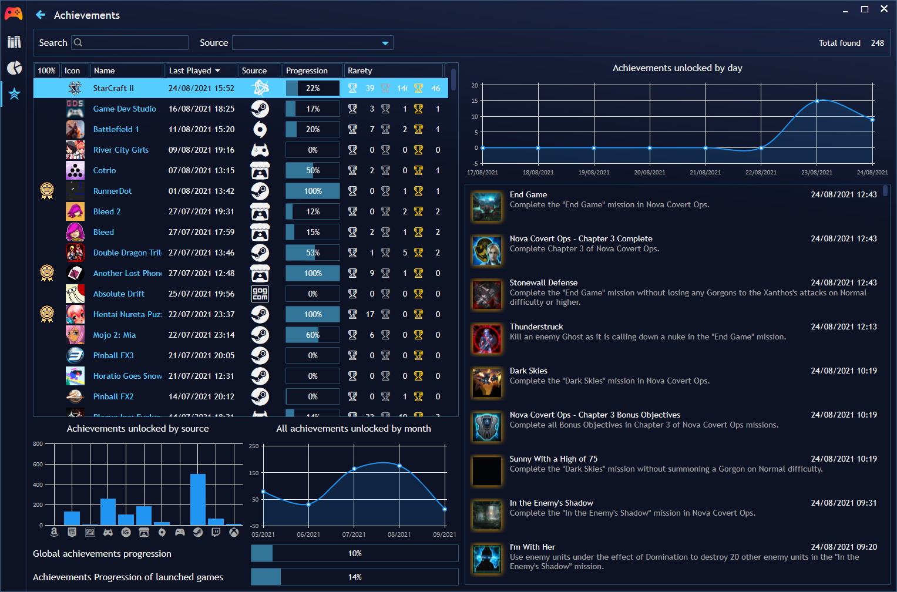
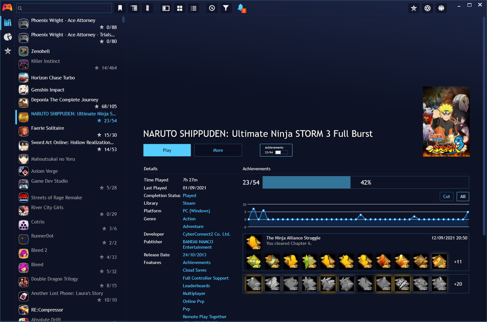
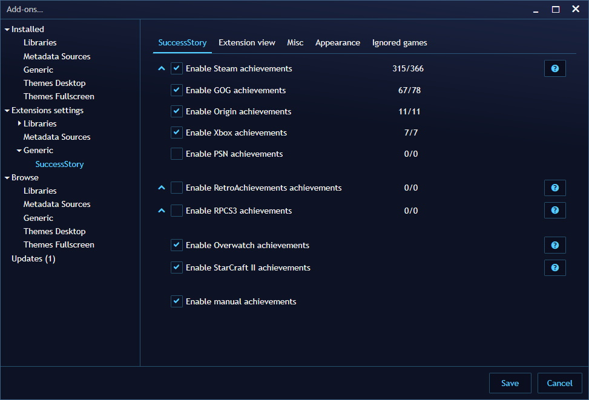

# SuccessStory

Achievements companion for [Playnite](https://playnite.link): progression, rarity, gamer score and
unlock history for every game in your library, from your own account or imported manually.

> Fork of [Lacro59/playnite-successstory-plugin](https://github.com/Lacro59/playnite-successstory-plugin)
> with a few local fixes; see the commit log.





## Features

- Achievement sources: Steam, GOG, Epic, EA, Xbox, Xbox 360, PlayStation, RetroAchievements,
  Game Jolt, Guild Wars 2, World of Warcraft, Overwatch, StarCraft II, RPCS3, ShadPS4
- Manual achievements, including imports from Genshin Impact / Wuthering Waves / Honkai: Star Rail /
  Zenless Zone Zero trackers
- Progression, rarity, gamer score, unlock-date charts and user statistics
- Optional tags, custom UI elements and data blocks for themes

## Install

Copy this folder to `%APPDATA%\Playnite\Extensions\playnite-successstory-plugin`, then restart Playnite
and configure your sources under **Add-ons → Extension settings → SuccessStory**.

## Build

Needs Visual Studio's MSBuild and the .NET Framework 4.6.2 Developer Pack (no .NET SDK required).

```powershell
nuget restore source\SuccessStory.sln
msbuild source\SuccessStory.sln /t:Build /p:Configuration=Debug
```

The output in `source\bin\Debug` is already in Playnite extension layout.

## Translations

Managed on [Crowdin](https://crowdin.com/project/playnite-extensions).

## Licence

MIT, see [LICENSE](LICENSE). Original plugin by Lacro59; icons by Freepik; data from SteamDB and
Steam Hunters.
